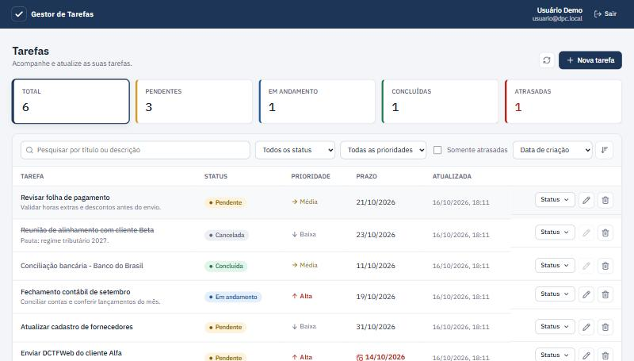
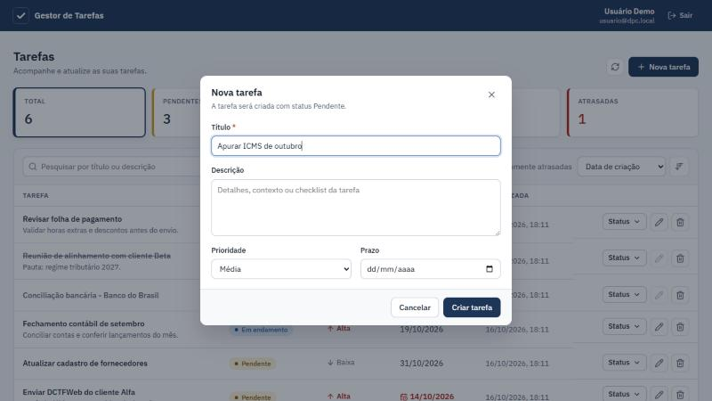

# Gestor de Tarefas

Aplicação web para gerenciamento de tarefas, desenvolvida como desafio técnico para a vaga de Analista de Desenvolvimento.

- **Backend:** API REST em .NET 9 / C#, com Swagger, autenticação JWT e persistência em SQLite via Entity Framework Core.
- **Frontend:** React 19 + TypeScript (Vite), com interface corporativa responsiva.
- **Extras:** testes automatizados (backend e frontend), Docker Compose, CI no GitHub Actions, autenticação e autorização, pesquisa, filtros, ordenação, paginação e indicadores.

---

## Sumário

1. [Visão geral](#1-visão-geral)
2. [Tecnologias](#2-tecnologias)
3. [Como executar](#3-como-executar)
4. [Manual de uso](#4-manual-de-uso)
5. [API](#5-api)
6. [Regras de negócio](#6-regras-de-negócio)
7. [Arquitetura e organização do código](#7-arquitetura-e-organização-do-código)
8. [Decisões técnicas](#8-decisões-técnicas)
9. [Testes](#9-testes)
10. [Como fiz, dificuldades e facilidades](#10-como-fiz-dificuldades-e-facilidades)
11. [Próximos passos](#11-próximos-passos)

---

## 1. Visão geral

O sistema permite que cada usuário cadastre e acompanhe as próprias tarefas:

- **CRUD completo:** criar, listar, ver, editar e excluir tarefas.
- **Controle de status** com regras de transição: Pendente → Em andamento → Concluída, além de Cancelada e reabertura.
- **Prioridade e prazo**, com destaque automático para tarefas **atrasadas**.
- **Pesquisa** por título/descrição, **filtros** (status, prioridade, atrasadas), **ordenação** e **paginação** no servidor.
- **Indicadores** no topo da tela (total, pendentes, em andamento, concluídas, atrasadas), que também funcionam como filtros rápidos.
- **Autenticação** com e-mail e senha (JWT) e **autorização** por dono da tarefa e perfil (usuário comum ou administrador).



## 2. Tecnologias

| Camada | Tecnologia | Uso |
|---|---|---|
| Backend | .NET 9, ASP.NET Core (Controllers) | API REST |
| | Entity Framework Core 9 + SQLite | Persistência e migrations |
| | FluentValidation | Validação das requisições |
| | JWT Bearer | Autenticação |
| | Swashbuckle (Swagger / OpenAPI) | Documentação interativa dos endpoints |
| | xUnit, FluentAssertions, WebApplicationFactory | Testes unitários e de integração |
| Frontend | React 19 + TypeScript + Vite | SPA |
| | React Router | Rotas e filtros na URL |
| | TanStack Query | Cache e sincronização com a API |
| | lucide-react | Ícones |
| | Vitest + Testing Library | Testes de componentes |
| Infra | Docker, Docker Compose, nginx | Execução em contêineres |
| | GitHub Actions | CI (build, lint e testes) |

## 3. Como executar

### Opção A: Docker (mais simples)

Pré-requisito: Docker Desktop.

```bash
docker compose up --build
```

- Aplicação: http://localhost:8080
- Swagger: http://localhost:8080/swagger
- Health check: http://localhost:8080/health

O nginx do contêiner `web` serve o React e repassa `/api` e `/swagger` para a API. O banco SQLite fica no volume `taskmanager-data`, então os dados sobrevivem a reinícios. Para usar uma chave JWT própria, copie `.env.example` para `.env` e preencha `JWT_KEY`.

### Opção B: localmente, sem Docker

Pré-requisitos: [.NET SDK 9](https://dotnet.microsoft.com/download) e [Node.js 20+](https://nodejs.org).

**1. API** (porta 5080):

```bash
dotnet run --project backend/TaskManager.Api --launch-profile http
```

Na primeira execução a API cria o arquivo `taskmanager.db`, aplica as migrations e popula dados de demonstração. Swagger em http://localhost:5080/swagger.

**2. Frontend** (porta 5173), em outro terminal:

```bash
cd frontend
npm install
npm run dev
```

Acesse http://localhost:5173. Em desenvolvimento o Vite repassa `/api` para `localhost:5080`, então não há configuração de CORS a fazer.

### Contas de demonstração

Criadas automaticamente em desenvolvimento e no Docker:

| Perfil | E-mail | Senha | O que vê |
|---|---|---|---|
| Usuário | `usuario@dpc.local` | `Usuario@123` | Só as próprias tarefas |
| Administrador | `admin@dpc.local` | `Admin@123` | Tarefas de todos os usuários, com a coluna Responsável |

Também é possível criar uma conta nova pela tela de login ("Criar conta").

### Configuração

Tudo pode ser sobrescrito por variável de ambiente (`Secao__Chave`):

| Chave | Padrão | Descrição |
|---|---|---|
| `ConnectionStrings__Default` | `Data Source=taskmanager.db` | Arquivo do SQLite |
| `Jwt__Key` | (vazio; obrigatório) | Chave HS256, mínimo de 32 caracteres. A API não sobe sem ela |
| `Jwt__ExpirationMinutes` | `480` | Validade do token |
| `BusinessClock__TimeZone` | `America/Sao_Paulo` | Fuso usado para "hoje" e para tarefas atrasadas |
| `Seed__Enabled` | `false` (`true` em Development) | Cria usuários e tarefas de demonstração em banco vazio |
| `Swagger__Enabled` | `true` | Publica o Swagger |
| `Cors__AllowedOrigins__0` | `http://localhost:5173` | Origens liberadas para chamar a API direto |
| `RateLimiting__AuthPermitLimit` | `10` | Tentativas de login/cadastro por minuto por IP |
| `ReverseProxy__Enabled` | `false` | Lê o IP real do cliente em `X-Forwarded-For` (ligado no Docker) |

## 4. Manual de uso

**Entrar.** Informe e-mail e senha. Sem conta, clique em **Criar conta** (nome, e-mail e senha com no mínimo 8 caracteres, letras e números). A sessão dura 8 horas; ao expirar, o sistema volta para o login.

**Indicadores.** Os cartões no topo mostram os totais por situação. Clicar em um cartão filtra a lista (ex.: **Atrasadas**); clicar de novo remove o filtro.

**Pesquisar e filtrar.** Na barra acima da lista:
- campo de pesquisa (busca no título e na descrição, enquanto você digita);
- filtros de status e prioridade;
- **Somente atrasadas**;
- ordenação (criação, atualização, prazo, prioridade, título, status) e o botão ao lado, que alterna crescente/decrescente;
- **Limpar filtros** aparece quando há algum filtro ativo.

Os filtros ficam na URL: dá para recarregar a página ou mandar o link para alguém sem perder a consulta.

**Criar tarefa.** Botão **Nova tarefa** → título (obrigatório), descrição, prioridade e prazo. Toda tarefa nasce **Pendente**. O prazo não pode estar no passado.

**Mudar status.** Botão **Status** na linha da tarefa. O menu só mostra as mudanças permitidas para a situação atual: Iniciar, Concluir, Cancelar, Voltar para pendente ou Reabrir.

**Editar.** Ícone de lápis. Tarefas **concluídas ou canceladas não podem ser editadas**; reabra antes (o lápis fica desabilitado e explica isso ao passar o mouse).

**Excluir.** Ícone de lixeira, com confirmação.

**Atrasadas.** Uma tarefa aberta (pendente ou em andamento) com prazo anterior a hoje aparece com o prazo em vermelho e entra no indicador **Atrasadas**.

No celular a tabela vira uma lista de cartões, com as mesmas ações.



## 5. API

Documentação interativa completa no **Swagger** (`/swagger`). Para testar rotas protegidas: chame `POST /api/auth/login`, copie o `accessToken` e cole no botão **Authorize**.

| Método | Rota | Descrição |
|---|---|---|
| POST | `/api/auth/register` | Cadastra usuário (perfil comum) e devolve o token |
| POST | `/api/auth/login` | Autentica e devolve o token |
| GET | `/api/auth/me` | Dados do usuário autenticado |
| GET | `/api/tasks` | Lista com pesquisa, filtros, ordenação e paginação |
| GET | `/api/tasks/summary` | Totais por status e atrasadas |
| GET | `/api/tasks/{id}` | Detalhe |
| POST | `/api/tasks` | Cria |
| PUT | `/api/tasks/{id}` | Edita título, descrição, prioridade e prazo |
| PATCH | `/api/tasks/{id}/status` | Muda o status |
| DELETE | `/api/tasks/{id}` | Exclui |
| GET | `/health` | Health check (inclui conexão com o banco) |

Parâmetros de `GET /api/tasks`: `search`, `status` (`Pending`, `InProgress`, `Completed`, `Cancelled`), `priority` (`Low`, `Medium`, `High`), `overdue`, `dueFrom`, `dueTo`, `sortBy` (`CreatedAt`, `UpdatedAt`, `DueDate`, `Priority`, `Title`, `Status`), `sortDirection` (`Asc`, `Desc`), `page`, `pageSize` (1 a 100).

Exemplo:

```http
POST /api/tasks
Authorization: Bearer <token>
Content-Type: application/json

{ "title": "Enviar DCTFWeb", "description": "Cliente Alfa", "priority": "High", "dueDate": "2026-10-30" }
```

### Tratamento de erros

Todos os erros seguem o padrão **ProblemDetails** (RFC 9457), em português:

| Status | Quando |
|---|---|
| 400 | Dados inválidos. O corpo traz `errors` por campo, que o frontend mostra ao lado de cada input |
| 401 | Sem token, token expirado ou login inválido |
| 404 | Tarefa inexistente ou de outro usuário |
| 409 | E-mail já cadastrado |
| 422 | Regra de negócio violada (transição de status proibida, edição de tarefa fechada) |
| 429 | Excesso de tentativas de login/cadastro |
| 500 | Erro inesperado: mensagem genérica para o cliente, detalhes só no log |

```json
{
  "status": 400,
  "title": "Dados inválidos",
  "detail": "Um ou mais campos não passaram na validação.",
  "errors": { "title": ["O título é obrigatório."], "dueDate": ["O prazo não pode estar no passado."] }
}
```

## 6. Regras de negócio

**Transições de status** (implementadas na entidade `TaskItem`, no domínio):

| De \ Para | Pendente | Em andamento | Concluída | Cancelada |
|---|:-:|:-:|:-:|:-:|
| **Pendente** | | ✔ | ✔ | ✔ |
| **Em andamento** | ✔ | | ✔ | ✔ |
| **Concluída** | ✔ (reabrir) | ✔ (reabrir) | | ✘ |
| **Cancelada** | ✔ (reativar) | ✘ | ✘ | |

- Concluir registra `completedAt`; reabrir limpa.
- Tarefa concluída ou cancelada não pode ser editada.
- Prazo no passado é rejeitado na criação. Na edição é aceito, porque uma tarefa já atrasada precisa continuar editável.
- "Hoje" segue o fuso de Brasília (configurável), e não o UTC do servidor.
- Usuário comum só acessa as próprias tarefas. Administrador acessa todas. O cadastro público sempre cria usuário comum.

## 7. Arquitetura e organização do código

```
├── backend/
│   ├── TaskManager.Domain/          Entidades, enums e regras de negócio (sem dependências)
│   ├── TaskManager.Application/     Casos de uso (services), DTOs, validações e interfaces
│   ├── TaskManager.Infrastructure/  EF Core, repositórios, migrations, JWT, hash de senha, seed
│   ├── TaskManager.Api/             Controllers, tratamento de erros, Swagger, autenticação
│   └── Dockerfile
├── tests/TaskManager.Tests/         Testes unitários (domínio, segurança) e de integração (API)
├── frontend/
│   ├── src/api/                     Cliente HTTP, tipos e endpoints
│   ├── src/auth/                    Sessão e contexto de autenticação
│   ├── src/components/              Tabela, filtros, formulário, modal, toasts…
│   ├── src/pages/                   Login e Tarefas
│   ├── src/lib/                     Rótulos em português, datas e validação
│   ├── nginx.conf / Dockerfile
├── docker-compose.yml
└── .github/workflows/ci.yml
```

As dependências apontam para dentro: `Api → Infrastructure → Application → Domain`. O domínio não conhece EF Core nem ASP.NET, e a camada Application depende só de interfaces (`ITaskRepository`, `IUnitOfWork`, `ICurrentUser`, `IBusinessClock`…), implementadas na Infrastructure.

Fluxo de uma requisição: **Controller** (fino, só HTTP) → **Service** (valida com FluentValidation, aplica escopo do usuário, orquestra) → **Entidade** (aplica a regra de negócio) → **Repositório / UnitOfWork** (persiste). Exceções sobem até o `GlobalExceptionHandler`, que as converte no status HTTP certo.

## 8. Decisões técnicas

- **Camadas no estilo Clean Architecture, sem exagero.** Separar Domain, Application, Infrastructure e Api deixa as regras testáveis sem banco e facilita trocar a persistência. Não usei MediatR/CQRS: para um CRUD deste tamanho, services diretos são mais fáceis de ler.
- **Regras no domínio.** As transições de status ficam na entidade `TaskItem` (setters privados e métodos `ChangeStatus`/`Update`). Assim a regra vale para qualquer ponto de entrada, e não só para o controller.
- **SQLite.** O desafio deixa o banco à escolha. O SQLite permite rodar com um único `dotnet run`, sem instalar servidor de banco, o que simplifica a avaliação. Como o acesso é via EF Core e repositórios, migrar para PostgreSQL ou SQL Server é trocar o provider e gerar novas migrations.
- **Migrations aplicadas na inicialização.** Prático para o desafio e para o Docker. Em produção com várias instâncias eu rodaria as migrations em um passo separado do deploy.
- **JWT próprio em vez de ASP.NET Identity.** O escopo pede só login e cadastro; o Identity traria várias tabelas e fluxos não usados. Senhas com PBKDF2-SHA256 (100 mil iterações, salt aleatório, comparação em tempo constante).
- **404 em vez de 403** para tarefa de outro usuário, para não revelar que o id existe.
- **422 para regra de negócio** e 400 para formato/validação: o cliente distingue "dado mal preenchido" de "operação não permitida no estado atual".
- **Enums como texto no JSON e como inteiro no banco.** O JSON fica legível (`"InProgress"`); no banco, a ordenação por prioridade segue a ordem do enum (Baixa < Média < Alta) e não a ordem alfabética.
- **Datas:** `DateOnly` para prazo (não tem hora nem fuso) e `DateTime` UTC para auditoria. O frontend formata o prazo sem converter fuso, para não "voltar um dia".
- **Paginação, filtros e ordenação no servidor**, com desempate estável por data e id, para a paginação não repetir nem pular itens.
- **Frontend sem biblioteca de componentes.** CSS próprio com tokens (cores, raios, sombras) para manter a interface consistente e leve. Os filtros vivem na URL, e o TanStack Query cuida de cache, loading e atualização após cada mutação.
- **Erros de validação da API ligados aos campos** do formulário: a mesma mensagem do backend aparece embaixo do input correspondente.
- **Segurança:** rate limit em login/cadastro, chave JWT obrigatória (a API não sobe sem ela), mensagens de erro sem detalhes internos, contêiner da API rodando com usuário sem privilégios e acessível só pela rede interna do Compose.

## 9. Testes

```bash
# Backend: 39 testes (domínio, hash de senha e integração da API com banco real)
dotnet test

# Frontend: 13 testes (componentes e utilitários)
cd frontend && npm test
```

- **Domínio:** todas as transições permitidas e proibidas, edição de tarefa fechada, `completedAt`, regra de atraso.
- **Integração (WebApplicationFactory + SQLite descartável):** fluxo completo de CRUD, 401 sem token, validação 400, transição proibida 422, isolamento entre usuários, pesquisa/filtros/paginação, resumo, cadastro duplicado 409, login inválido 401 e Swagger disponível.
- **Frontend:** menu de status mostra só as transições permitidas, validação do formulário, erro da API exibido no campo, formatação de datas.

O GitHub Actions roda build, lint e todos os testes a cada push e também sobe o Docker Compose, validando health check, frontend, Swagger e login de ponta a ponta.

## 10. Como fiz, dificuldades e facilidades

**Como fiz.** Comecei pelo domínio (entidade, status e regras de transição), depois a camada de aplicação com validações e casos de uso, a infraestrutura com EF Core e, por fim, a API. Com o backend testado e documentado no Swagger, construí o frontend consumindo os mesmos contratos e validei os fluxos no navegador, inclusive no tamanho de celular.

**Dificuldades.**
- **Datas e fuso.** O SQLite não guarda o `Kind` do `DateTime`, e a API devolvia datas sem o `Z` de UTC, o que faria o navegador interpretar como hora local. Resolvi com um conversor no EF Core. Também percebi que "hoje" calculado em UTC rejeitaria prazos para o dia atual à noite no Brasil (após 21h, já é o dia seguinte em UTC); por isso criei o `IBusinessClock`, com o fuso configurável.
- **Mensagens de erro de binding.** Por padrão, um enum inválido no JSON gerava erro em inglês expondo o nome interno do tipo. Criei uma resposta padronizada, em português, no mesmo formato dos erros de validação.
- **Rate limit atrás do nginx.** No Docker, todas as requisições chegariam com o IP do proxy e dividiriam o mesmo limite. Habilitei a leitura de `X-Forwarded-For` quando a API roda atrás do proxy.
- **Limitações do SQLite** com alguns tipos (ordenação por `DateTimeOffset`, por exemplo), o que influenciou a escolha de `DateTime` UTC e `DateOnly`.

**Facilidades.**
- EF Core com migrations e `WebApplicationFactory` tornam simples testar a API de ponta a ponta com um banco real descartável.
- FluentValidation + ProblemDetails dão um formato único de erro, fácil de consumir no frontend.
- TanStack Query reduz muito o código de estado no React (loading, erro, cache e recarga após cada alteração).

## 11. Próximos passos

- Banco relacional gerenciado (PostgreSQL) para produção e publicação online.
- Refresh token e revogação de sessão.
- Histórico de alterações da tarefa (quem mudou o status e quando).
- Atribuir tarefas a outros usuários e comentários.
- Testes end-to-end com Playwright.
